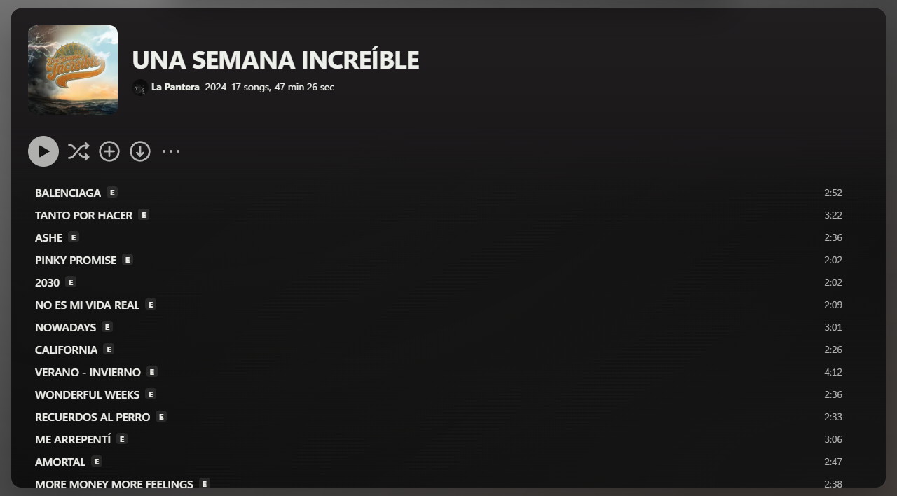

# Calma

A quieter space for your music. Calma brings artwork-aware color, a floating glass player and restrained motion to Spotify desktop.

[Download the latest release](https://github.com/ell1zv4/calma-spicetify/releases/latest) · [Español](README.es.md)



## What changes

- An uncluttered Home gallery with up to nine albums and personal playlists, cover-colored hover light and a reversible artwork transition.
- Album and playlist colors that continue into a soft header gradient.
- Compact song lists with a brief, staggered entrance and quiet playback feedback. Entry does not repeat while scrolling.
- Floating playback controls, a transparent library rail and native context menus.
- Responsive Home columns, visible keyboard focus and device-aware reduced motion.
- Optional audio previews that only run while Spotify is paused. They are off by default.
- Optional styling and middle-click fullscreen support for [ivLyrics](https://github.com/ivLis-Studio/ivLyrics). The lyrics app is installed separately.

## Install

### Marketplace

Open **Marketplace → Themes**, search for **Calma**, and install it. Reload Spotify after installation or an update so its JavaScript is refreshed. Discovery depends on GitHub's topic index; the release download below is also available.

### Manual

1. Install [Spicetify](https://spicetify.app/docs/getting-started).
2. Download `Calma-v1.0.0.zip` from [Releases](https://github.com/ell1zv4/calma-spicetify/releases/latest).
3. Extract the `Calma` folder into your Spicetify `Themes` directory:

   | Platform | Directory |
   | --- | --- |
   | Windows | `%appdata%\spicetify\Themes\` |
   | Linux / macOS | `~/.config/spicetify/Themes/` |

4. Run:

   ```sh
   spicetify config current_theme Calma color_scheme Calma inject_theme_js 1
   spicetify apply
   ```

Keep `user.css`, `theme.js` and `color.ini` together. JavaScript is required for the gallery, adaptive colors and settings.

## Settings

Right-click the small **library button in the player** to open Calma settings. With keyboard focus on that button, the context-menu key or **Shift+F10** opens the same settings on Windows.

- **Motion:** follow your device, full, or reduced. Reduced mode keeps short fades without spatial movement.
- **Audio previews:** opt in to six-second previews while your music is paused. Availability depends on Spotify; a missing preview never interrupts playback.
- **Sort and view controls:** show Spotify's native selector when you need it.
- **Pinned playlist:** open your playlist, then choose **Pin this playlist to Home** in Calma settings. You can unpin or reset preferences there.

These preferences stay in this Spotify installation. No account, email, personal playlist or API key is bundled with the theme. Calma has no analytics.

Middle-click opens fullscreen lyrics only when ivLyrics is available. Without it, Calma preserves the native middle-click behavior. It does not generate lyric timings, require AI keys or install additional apps.

## Compatibility

Verified on **Windows with Spotify 1.3.9.2055 and Spicetify 2.46.7**. macOS and Linux have platform-aware fallbacks but have not been tested on native hardware for this release. Spotify UI updates can change selectors; update Spicetify and reload before reporting a compatibility issue.

Home uses Spotify's loaded recommendations and can show fewer than nine items on an empty or newly created account. Very long playlists still depend on Spotify's loading and rendering performance. The artwork flight animates one image; it does not delay navigation or capture the entire window.

To return to Spotify's default theme:

```sh
spicetify config current_theme "" color_scheme ""
spicetify apply
```

## Development

No npm dependencies or build step are required. With Node.js 22 or later:

```sh
node tools/validate.cjs
node --test "tests/*.cjs"
```

Checks cover native Back navigation, artwork cancellation and rounding, row entry, playback state, palette extraction, preferences and optional dependencies. See [CHANGELOG.md](CHANGELOG.md).

## License

Calma's code is [MIT licensed](LICENSE). Spotify, Spicetify, ivLyrics and album artwork belong to their respective owners. This is an independent community theme and is not affiliated with Spotify.
